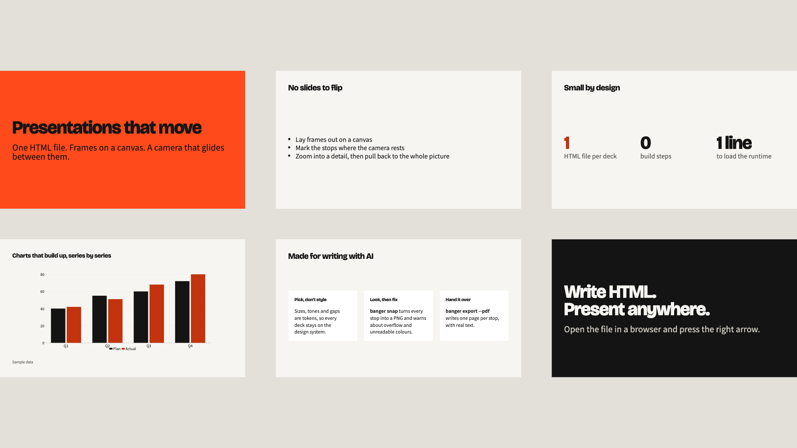
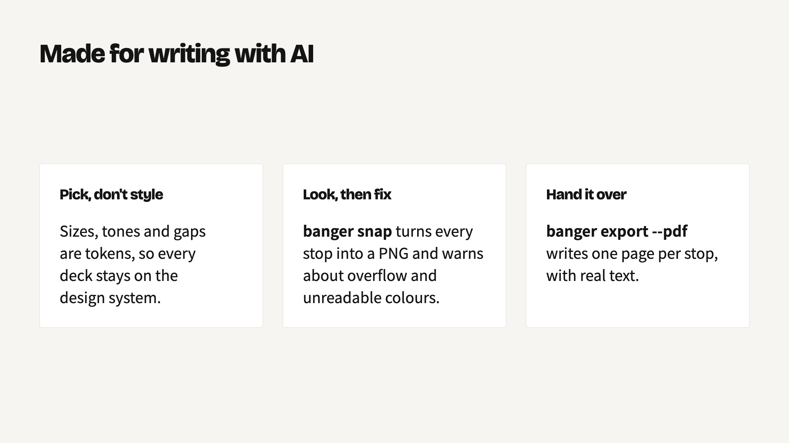

Banger
======

**動くプレゼンを、HTML 1 枚で書く。**

[English](README.md) | 日本語



Banger は、フレームをキャンバスの上に並べ、その間をカメラで移動します。数字に寄り、次の話へ滑らかに移り、最後に引いて全体を見せる、という発表ができます。めくるスライドはなく、ビルドも要りません。発表は HTML 1 枚で、どのブラウザでも開け、git で管理でき、AI が最初から最後まで書ける大きさに収まります。

## 特徴

- **1 ファイル、1 行。** `<script>` タグ 1 つでランタイムを読み込み、`bang-*` 要素で発表を書きます。バンドラーもフレームワークも、専用のエディタも要りません。
- **めくらず、動く。** フレームは格子の上に置きます。停止点が、カメラの止まる場所を決めます。フレーム全体、その一部、その中の 1 つの要素、全体の見渡し、のいずれかです。
- **何もしなくても見栄えがよい。** 大きさ・色の調子・間隔は自由な CSS ではなくトークンで選ぶので、誰が書いてもデザインシステムから外れません。同梱のテーマを選ぶか、色とフォントを自分で決められます。読みにくい色の組み合わせは警告されます。
- **AI と書くために作った。** 語彙は小さく、`skill/` に説明があります。AI は発表を書き、`banger snap` で停止点をすべて画像にし、その画像を見てはみ出しを直せます。
- **本番で使える。** 箇条書きとグラフの系列を段階的に出す、発表者ノートを別のウィンドウに出す、全画面にする、文字を選べる PDF に書き出す、ができます。



## 試す

次を `index.html` として保存し、ブラウザで開きます。右矢印で進み、`o` でキャンバス全体を見られます。

```html
<!doctype html>
<meta charset="utf-8">
<title>My talk</title>
<script type="module" src="https://cdn.jsdelivr.net/npm/@bangerpage/core@0.1.1/dist/index.js"></script>
<bang-root theme="light">
  <bang-frame id="hello" at="0,0">
    <bang-title>Hello</bang-title>
    <bang-list step="1">
      <li>Frames sit on a canvas</li>
      <li>The camera stops where you tell it to</li>
    </bang-list>
  </bang-frame>
  <bang-frame id="more" at="1,0" tone="accent">
    <bang-title size="2xl">Next idea</bang-title>
  </bang-frame>
  <bang-path>
    <bang-stop frame="hello" steps="2"><bang-notes>Say hello</bang-notes></bang-stop>
    <bang-stop frame="more"></bang-stop>
    <bang-stop overview></bang-stop>
  </bang-path>
</bang-root>
```

`npx @bangerpage/cli init my-talk` で、CLI にひな形を書かせることもできます。

書いたら、発表のディレクトリで CLI を使います (Node 22 以上と Chrome が要ります)。

```
npx @bangerpage/cli preview       # 編集しながら自動で再読み込み
npx @bangerpage/cli snap          # 停止点ごとに 1920x1080 の PNG
npx @bangerpage/cli export --pdf  # 停止点ごとに 1 ページの PDF
```

もっと大きな例は `examples/showcase/index.html` (上の画像の発表) にあります。

## 発表する

| 操作 | 動き |
| --- | --- |
| 右矢印、Space、Page Down、Enter | 次の段か停止点へ |
| 左矢印、Backspace、Page Up | 前の段か停止点へ |
| Home / End | 最初 / 最後の停止点へ |
| `o` か Esc | キャンバス全体の見渡し |
| 見渡しでフレームをクリック | そのフレームへ移る |
| `p` | 発表者ノートのウィンドウ (観客のウィンドウと同期する) |
| `f` | 全画面 |
| `?` | キーボードの操作の一覧 |
| 左右にスワイプ | 次 / 前へ (タッチスクリーン) |
| マウスを上か左 / 下か右へすばやく大きく動かす | 次 / 前へ (マウスのドラッグを送るページめくり機) |

ページめくり機で一度めくると、それ以降は文字を選択できなくなり、マウスカーソルも隠れます。手でマウスを動かすと元に戻ります。

いまの位置は URL (`#stop=N&step=M`) に入るので、再読み込みしても、共有したリンクを開いても、同じ場所から始まります。

## AI と書く

`skill/` は AI のための skill です。`SKILL.md` に手順と決まり、`reference/` にすべての要素・属性・型の例、`templates/starter.html` にひな形があります。skill の本文は日本語、要素の一覧は英語です。

CLI は、その版に合った skill を同梱しています。Claude Code で使うときは、skill を入れてから発表を頼みます。

```
npm install -g @bangerpage/cli
banger skill install             # ~/.claude/skills/banger に書く
banger skill install --project   # このプロジェクトだけなら ./.claude/skills/banger
```

CLI を更新した後にもう一度実行すると、skill も置き換わります。`banger` が書いていないディレクトリは、`--force` を付けない限り触りません。ほかの AI で使うときは、`--dir <path>` でその AI が skill を読む場所に書けます。

skill を入れた AI は、停止点の並びで構成を合意してから `index.html` を書きます。書いたら `banger check` と `banger snap` で停止点をすべて確かめ、CLI の警告 (はみ出し、存在しないタグ、読みにくい色、描画に失敗した部品) を直します。

## 要素

| 要素 | 役割 |
| --- | --- |
| `bang-root` | 発表全体。テーマを選ぶ。 |
| `bang-frame` | キャンバスの上の 1920x1080 の領域。`at="列,行"` で置く。 |
| `bang-path`、`bang-stop` | カメラの停止点の順。フレーム、その一部 (`region`)、その中の 1 つの要素 (`focus`)、見渡し (`overview`) のいずれか。 |
| `bang-title`、`bang-text`、`bang-list` | 見出し・段落・箇条書き。段階的に出せる。 |
| `bang-columns`、`bang-stack`、`bang-card` | レイアウト。 |
| `bang-stat`、`bang-chart`、`bang-image`、`bang-shape` | 大きな数字、グラフ、画像、矢印と印。 |
| `bang-free` | 部品で描けない図のための、自由な HTML・CSS・SVG。 |
| `bang-notes` | 停止点の発表者ノート。 |
| `bang-theme` | JSON で書くカスタムテーマ。 |

属性と値の一覧は `skill/reference/components.md` にあります。

## パッケージ

- `packages/core` (`@bangerpage/core`): ランタイム (カスタム要素、カメラ、状態) とテーマ。
- `packages/cli` (`@bangerpage/cli`): `banger` コマンド (プレビュー、PNG、PDF の書き出し、テーマ) と、PDF の書き出しを呼べるライブラリ。
- `skill/`: AI のための skill (`SKILL.md`、要素の一覧、型の例、ひな形)。
- `examples/showcase`: 上の画像の発表。
- `examples/minimal`: 主な部品を使った小さな発表。

`bang-root format="map"` にすると、フレームを地図のように並べます (地面、つながったフレームの間の道、まだ話していない場所にかかる霧)。実験的な機能で、見た目と属性はどの版でも変わることがあります。

## 詳しい説明

### 版とネットワーク

- ランタイムの URL には、版を正確に書きます (`@bangerpage/core@0.1.0`)。`@0` や `@0.1` のような範囲は書きません。ランタイムは分割したファイルを相対パスで読み込むので、範囲の指す版が変わると、古い入口をキャッシュしたページが壊れることがあります。版が `0.x` のあいだは、マイナーリリースで要素・属性・テーマのキーの名前が変わることがあります。版を固定した発表は、書いた版のまま動き続けます。動いている版は `customElements.get("bang-root").version` で分かります。
- CLI は、同梱した core で発表を描画します。発表が別の版を指しているときは警告を出します。発表は、その版に合った CLI で確かめてください。
- 発表を開くと、ランタイムを CDN から、フォントを Google Fonts (`fonts.googleapis.com` と `fonts.gstatic.com`) から読み込みます。そのためネットワークが要り、見る人のブラウザがそれらのホストに接続します。カスタムテーマでフォントを変えられますが (`fontsHref`)、既定のフォントも読み込まれます。

### カスタムテーマ

`bang-root` に `theme="custom"` を書き、子に JSON の script を持つ `bang-theme` を置きます。書かなかったキーは `base` (`light` か `dark`) の値になります。

```html
<bang-root theme="custom">
  <bang-theme>
    <script type="application/json">
      { "base": "dark", "paper": "#0F1B2D", "ink": "#F2F5FA", "signal": "#FFB000" }
    </script>
  </bang-theme>
  ...
</bang-root>
```

テーマでは、色とフォントのほかに、組版 (太さ・行間・字間)、地・表紙・帯のグラデーション、カードの影と角丸 (`cardShadow`、`cardRadius`)、accent のフレームの文字色 (`onSignal`) を決められます。キーの説明はすべて `skill/reference/themes.md` にあります。

同じ見た目を複数の発表で使うときは、`banger theme init` で `theme.json` を一度作り、発表ごとに `banger theme apply theme.json deck.html` を実行します。色のコントラストは描画のときに確かめられ、読みにくい組み合わせは `banger snap` が `warning:` の行で知らせます。

### CLI

- `banger init [dir] [--force]`: ひな形から `index.html` を `dir` (既定は今のディレクトリ) に書いて、発表を始めます。
- `banger preview [file]`: 自動で再読み込みするプレビュー。`[file]` を省くと、`preview`・`snap`・`export` は今のディレクトリの `index.html` を使います。HTML の中のランタイムの URL は同梱の core から配るので、オフラインでも、公開前の版でも動きます。
- `banger snap [file] [--stop N] [--step M|last] [--steps last|all] [--out path] [--out-dir dir] [--scale 1|2]`: 状態を 1920x1080 の PNG に描きます。`--stop` を省くと、すべての停止点を最後の段で書きます。`--steps all` を付けると、途中の段もすべて書きます。PNG は実行ごとにバイト単位で同じになるとは限りません。文字のアンチエイリアスが 1 ピクセルずれることがあるので、比べるときは許容幅を持たせてください。
- `banger check [file] [--json]`: 画像を撮らずにすべての停止点を描画し、ランタイムが見つけた問題を一覧にします。フレームやカードからはみ出した中身、存在しない `bang-*` タグ、同じ格子に置いたフレーム、存在しないフレームを指す停止点、不正な属性の値、読みにくい色、描画に失敗した部品が対象です。問題があれば終了コード 1 で終わります。`--json` は `{ ok, stops, warnings, failed }` を出します。
- `banger export [file] --pdf [--out path] [--steps last|all]`: 停止点ごとに 1 ページの PDF を、ベクターの文字で書きます。
- `banger theme init [file] [--from <preset>] [--force]`: 同梱のプリセット (`signal`、`signal-dark`、`sunshine`、`midnight`) から `theme.json` を書きます。
- `banger theme apply <theme.json> <deck.html>`: テーマを発表に埋め込み、`theme="custom"` にします。何度実行しても結果は同じです。
- `banger skill install [--project | --dir <path>] [--force]`: この版の CLI に同梱した skill を `~/.claude/skills/banger` (または `./.claude/skills/banger`、`<path>`) に写します。
- `banger login [--token <token>]`: [banger.page](https://banger.page) にログインします。ブラウザが開くので、ログインして CLI を許可すると、トークンが `~/.config/banger/credentials.json` (自分だけが読める) に置かれます。ブラウザが無い環境では、サイトの設定画面で作ったトークンを `--token` で渡します。`banger logout` はトークンを取り消して消します。CI では代わりに `BANGER_TOKEN` を設定します。
- `banger publish [dir] [--slug <slug>] [--title <title>] [--visibility public|unlisted] [--strict] [--skip-check] [--dry-run]`: `dir` (既定は今のディレクトリ) の発表に `banger check` をかけてから、`index.html` と、その隣にある banger.page が受け付けるファイル (画像、フォント、動画、JSON、CSS、JS、`deck.pdf`。ドットファイルと `node_modules` は送らない) を送って公開します。slug の既定はディレクトリ名です。slug と URL は `.banger/deck.json` に残るので、次の実行では同じ発表を更新します。check の警告は、`--strict` を付けない限り公開を止めません。描画に失敗した部品があるときは、必ず止めます。

ターミナルで実行すると、CLI は 1 日に 1 回まで npm で新しい `@bangerpage/cli` を確かめ、次の実行で知らせます。この確認でコマンドが遅くなることはありません。`BANGER_NO_UPDATE_CHECK=1` で止められます (`CI` が設定されているときと、標準エラーがターミナルでないときも止まります)。

CLI は `playwright-core` で Chrome を動かします。ブラウザが見つからないときは、入れるためのコマンドを出して、終了コード 2 で終わります。

#### ライブラリとして使う

```ts
import { exportPdf } from "@bangerpage/cli";

const path = await exportPdf("deck.html", { steps: "last" });
```

`exportPdf` は、書いた PDF の絶対パスを返します。失敗すると `CliError` を投げ、その `exitCode` はコマンドとして実行したときの終了コードです (描画に失敗した発表は 1、入力の誤りは 2)。`onWarning` を渡すと、ランタイムの版の食い違いなどの警告を、標準エラーに書く代わりに受け取れます。

### 開発

```
pnpm install
pnpm gen         # テーマ、custom-elements.json、skill のファイルを作り直す
pnpm typecheck
pnpm build
pnpm test
pnpm -C packages/core exec playwright-core install chromium   # e2e のために一度だけ
pnpm test:e2e
```

CLI と examples は `packages/*/dist` を読み込むので、pull した後は、このチェックアウトで試す前に `pnpm build` を実行してください。

生成したファイル (`skill/reference/components.md`、ひな形・例・CLI のテストの中のランタイムの URL) は commit します。部品の属性や JSDoc を変えたら `pnpm gen` を実行し、結果を commit します。CI は `pnpm gen:check` を実行します。

### リリース

`v<version>` の tag を push すると、CI (`.github/workflows/release.yml`) が 2 つのパッケージを公開します。

1. `packages/core/package.json` と `packages/cli/package.json` に同じ `version` を書き、`pnpm gen` (ひな形・例・README・テストの中のランタイムの URL を更新する) を実行して commit します。
2. その commit を push し、`ci` が通るのを待ちます。
3. その commit に `v<version>` の tag を付けて push します。リリースの workflow は、tag と 2 つの版が一致するかを確かめ、すべての確認をもう一度実行してから、npm の trusted publishing で core、cli の順に公開し (リポジトリに npm の token は置かない)、GitHub の release を作ります。

trusted publishing は、パッケージごとに npmjs.com で一度だけ設定します。パッケージの設定で、GitHub のリポジトリ `bangerpage/banger` と workflow `release.yml` を trusted publisher として登録します。

## ライセンス

MIT。「Banger」という名前と Banger のロゴ (`examples/minimal/assets/banger-mark.svg` など) はライセンスの対象外です。あなたのプロジェクトが Banger である、または Banger に認められている、と思わせる使い方はできません。
