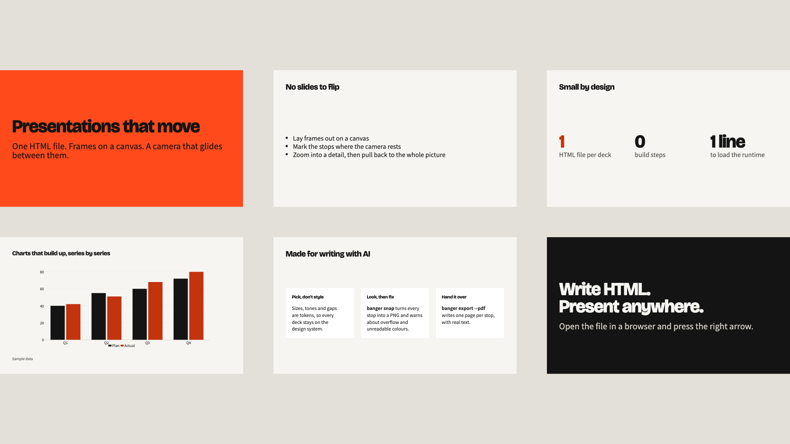
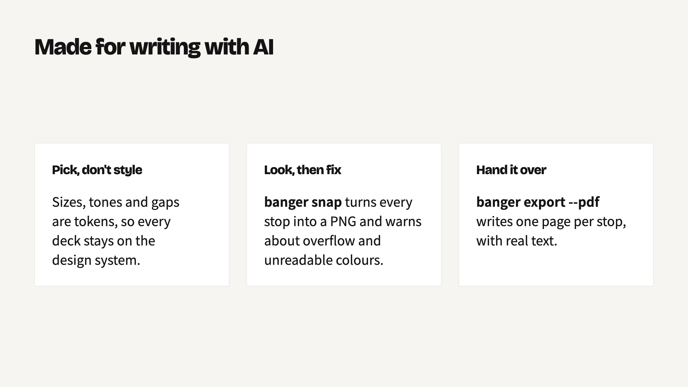

Banger
======

**Presentations that move, written as one HTML file.**

English | [日本語](README.ja.md)



Banger puts your frames on a canvas and moves a camera between them. Zoom into a number, glide to the next idea, then pull back and show the whole picture. There are no slides to flip and no build step: a deck is one HTML file that opens in any browser, lives happily in git, and is small enough for an AI to write from start to finish.

## Why Banger

- **One file, one line.** Load the runtime with a single `<script>` tag and write the deck with `bang-*` elements. No bundler, no framework, no editor to install.
- **A canvas, not a stack.** Frames sit on a grid. Stops decide where the camera rests: a whole frame, a region of it, one element in it, or the overview of everything.
- **Good-looking by default.** Sizes, tones and gaps are tokens, not free-form CSS, so a deck stays on the design system whoever writes it. Pick a bundled theme or bring your own colours and fonts; unreadable colour pairs are flagged.
- **Made for writing with AI.** The vocabulary is small and documented in `skill/`, so an agent can write a deck, render every stop with `banger snap`, look at the images and fix what overflows.
- **Ready for the stage.** Step-by-step reveals for lists and chart series, speaker notes in a presenter window, full screen, and a PDF export with real, selectable text.



## Try it

Save this as `index.html` and open it in a browser. Press the right arrow to move, `o` to see the whole canvas.

```html
<!doctype html>
<meta charset="utf-8">
<title>My talk</title>
<script type="module" src="https://cdn.jsdelivr.net/npm/@bangerpage/core@0.2.3/dist/index.js"></script>
<bang-root theme="light">
  <bang-frame id="hello" at="0,0">
    <bang-title>Hello</bang-title>
    <bang-list step="1">
      <li>Frames sit on a canvas</li>
      <li>The camera stops where you tell it to</li>
    </bang-list>
  </bang-frame>
  <bang-frame id="more" at="1,0" tone="accent">
    <bang-title size="2xl">Next idea</bang-title>
  </bang-frame>
  <bang-path>
    <bang-stop frame="hello" steps="2"><bang-notes>Say hello</bang-notes></bang-stop>
    <bang-stop frame="more"></bang-stop>
    <bang-stop overview></bang-stop>
  </bang-path>
</bang-root>
```

Or let the CLI write a starter for you with `npx @bangerpage/cli init my-talk`.

Then, from the deck's directory, use the CLI (it needs Node 22 or later and Chrome):

```
npx @bangerpage/cli preview       # live reload while you edit
npx @bangerpage/cli snap          # every stop as a 1920x1080 PNG
npx @bangerpage/cli export --pdf  # one PDF page per stop
```

For a fuller deck, open `examples/showcase/index.html` (the one in the pictures above).

## Presenting

| Key | Action |
| --- | --- |
| Right arrow, Space, Page Down, Enter | Next step or stop |
| Left arrow, Backspace, Page Up | Previous step or stop |
| Home / End | First / last stop |
| `o` or Esc | Overview of the whole canvas |
| Click a frame in the overview | Go to that frame |
| `p` | Presenter window with speaker notes, kept in sync with the audience window |
| `f` | Full screen |
| `l` | Next language, in a deck with `languages` |
| `?` | Keyboard shortcuts |
| Swipe left / right | Next / previous, on a touch screen |
| Quick long mouse flick up or left / down or right | Next / previous, for page-turner remotes that drag the mouse |

After the first flick from such a remote, the deck stops selecting text and hides the mouse cursor until you move the mouse by hand.

The current position is kept in the URL (`#stop=N&step=M`), so a reload or a shared link lands on the same place.

## Multilingual decks

One deck can carry several languages. List them on `bang-root` (the first is the author's language) and put each language's text next to the other as siblings, using the HTML `lang` attribute. The frames, stops, steps and theme are shared.

```html
<bang-root languages="ja en">
  <bang-frame id="hello" at="0,0" crumb="なぜ" crumb-en="Why">
    <bang-title>
      <span lang="ja">めくらない発表</span>
      <span lang="en">Presentations that move</span>
    </bang-title>
    <bang-list step="1">
      <li lang="ja">フレームはキャンバスに並ぶ</li>
      <li lang="en">Frames sit on a canvas</li>
    </bang-list>
  </bang-frame>
  ...
</bang-root>
```

An element with a `lang` is shown only while that language is selected; elements without `lang` are shown in every language. The language comes from `?lang=en` in the URL, then the browser's language settings, then the first language in `languages`. Press `l` while presenting to switch to the next language; the presenter window and the audience window switch together, and `?lang=` follows. Pin the runtime to `@bangerpage/core@0.2.0` or later for such a deck.

`banger check` renders every language and reports translation mistakes, such as a missing `<li>` in one language. `banger snap` and `banger export --pdf` take `--lang <language>|all`.

## Writing decks with AI

`skill/` is an agent skill: `SKILL.md` describes the workflow and the rules, `reference/` lists every element, attribute and pattern, and `templates/starter.html` is the starting point. The skill text is in Japanese; the element reference is in English.

In Claude Code, install it as a plugin. The plugin updates when a new version is released:

```
/plugin marketplace add bangerpage/banger
/plugin install banger@bangerpage
```

The skill also needs the CLI, which previews, checks and exports the deck: `npm install -g @bangerpage/cli`.

The CLI carries the skill that matches its version, and can write it out instead of the plugin:

```
banger skill install             # writes ~/.claude/skills/banger
banger skill install --project   # or ./.claude/skills/banger for this project only
banger skill pack                # writes banger-skill.zip
```

Running `banger skill install` again after updating the CLI replaces the copy; a directory that `banger` did not write is left alone unless you pass `--force`. For another agent, `--dir <path>` writes the skill wherever that agent reads skills from. `banger skill pack` writes a zip for the Claude app (claude.ai or Claude Desktop): upload it from the app's Skills settings. In the app the agent writes the HTML, but it may not be able to run the CLI.

With the skill, the agent agrees on the outline as a list of stops, writes `index.html`, runs `banger check` and `banger snap` to look at every stop, and fixes what the CLI warns about (overflow, unknown tags, unreadable colours, failed components).

## Elements

| Element | Purpose |
| --- | --- |
| `bang-root` | The deck. Picks the theme. |
| `bang-frame` | A 1920x1080 area on the canvas, placed with `at="col,row"`. |
| `bang-path`, `bang-stop` | The order of camera stops: a frame, a `region` of it, one element (`focus`), or the `overview`. |
| `bang-title`, `bang-text`, `bang-list` | Headings, paragraphs and lists, revealed step by step if you like. |
| `bang-columns`, `bang-stack`, `bang-card` | Layout. |
| `bang-stat`, `bang-chart`, `bang-image`, `bang-shape` | Big numbers, charts, images, arrows and marks. |
| `bang-free` | Free HTML, CSS and SVG for the figure no element can draw. |
| `bang-notes` | Speaker notes for a stop. |
| `bang-theme` | A custom theme as JSON. |

Every attribute and its values are in `skill/reference/components.md`.

## Packages

- `packages/core` (`@bangerpage/core`): the runtime (custom elements, camera, state) and its theme.
- `packages/cli` (`@bangerpage/cli`): the `banger` command (preview, PNG snapshots, PDF export, themes) and a library entry for PDF export.
- `skill/`: the AI skill (`SKILL.md`, component reference, patterns, starter template).
- `examples/showcase`: the deck in the pictures above.
- `examples/minimal`: a small deck that shows the main components.

`bang-root format="map"` lays the frames out as an experimental map (ground, roads between linked frames, fog over the parts not yet reached). Its look and attributes may change in any release.

## Reference

### Versions and network access

- Pin the exact runtime version in the URL (`@bangerpage/core@0.1.0`), not a range such as `@0` or `@0.1`. The runtime loads its chunks by relative path, so a range that moves to a new version can break a page that has the old entry cached. While the version is `0.x`, a minor release may rename elements, attributes or theme keys; a pinned deck keeps working on the version it names. The running version is `customElements.get("bang-root").version`.
- `dist/standalone.js` is the same runtime in one file (about 700 KB) with the lazy parts, such as the chart library, inlined. Use it where the runtime cannot load its other files by relative path: a deck that inlines the runtime into its own HTML, or a copy of the runtime saved next to a deck that is opened offline. Otherwise use `dist/index.js`, which loads less up front. Write `dist/index.js` in a deck published to banger.page.
- The CLI renders every deck with the core it bundles and prints a warning when the deck pins another version. Check a deck with the CLI version that matches its pin.
- Opening a deck loads the runtime from the CDN and the fonts from Google Fonts (`fonts.googleapis.com` and `fonts.gstatic.com`), so it needs network access, and each viewer's browser contacts those hosts. A custom theme can change the font families (`fontsHref`), but the default families are still requested.

### Custom theme

Set `theme="custom"` on `bang-root` and put a `bang-theme` child with a JSON script. Keys you leave out take the values of `base` (`light` or `dark`).

```html
<bang-root theme="custom">
  <bang-theme>
    <script type="application/json">
      { "base": "dark", "paper": "#0F1B2D", "ink": "#F2F5FA", "signal": "#FFB000" }
    </script>
  </bang-theme>
  ...
</bang-root>
```

Besides colours and fonts, a theme can set typography (weights, leading, tracking), gradients for the ground, covers and bands, card shadows and corners (`cardShadow`, `cardRadius`) and the text colour on accent frames (`onSignal`). Every key is described in `skill/reference/themes.md`.

To reuse one look across decks, keep a `theme.json` and run `banger theme init` once, then `banger theme apply theme.json deck.html` for each deck. Colors are checked for contrast when the deck is rendered, and `banger snap` prints a `warning:` line for unreadable combinations.

### CLI

- `banger init [dir] [--force]`: start a deck by writing `index.html` from the starter template into `dir` (default: the working directory).
- `banger preview [file]`: preview with live reload. Without `[file]`, `preview`, `snap` and `export` use `index.html` in the working directory. The runtime URL in the HTML is served from the bundled core, so it works offline and before publishing. In the presenter window (`p`), the top shows the logged-in banger.page account and, when you preview `index.html`, the deck's visibility, version and URL there. Only the preview server uses the token to look this up; it never reaches the browser, and nothing is shown offline.
- `banger snap [file] [--stop N] [--step M|last] [--steps last|all] [--out path] [--out-dir dir] [--scale 1|2] [--lang <language>|all]`: render states as 1920x1080 PNG files. Without `--stop` every stop is written at its last step; `--steps all` also writes every step on the way. In a deck with `languages`, `--lang <language>` renders that language and `--lang all` writes `snap/<language>/` for each one; without it the first language is used (`--lang all` cannot be combined with `--out`). The PNG files are not guaranteed to be byte-identical between runs: anti-aliasing of text can differ by a pixel, so compare them with a tolerance.
- `banger check [file] [--json]`: render every stop without taking pictures and list the problems the runtime finds: content that does not fit inside its frame or runs out of a card, `bang-*` tags that do not exist, frames on the same cell, stops naming a missing frame, invalid attribute values, unreadable colours and failed components. In a deck with `languages` it renders every language, prefixes each line with the language (`[en] `) and also reports translation mistakes. It exits 1 when there is any problem; `--json` prints `{ ok, stops, warnings, failed, notes }`. Web fonts that did not load (for example on a network that blocks Google Fonts) are printed as `note:` lines and do not count as problems; the layout is then checked with fallback fonts.
- `banger export [file] --pdf [--out path] [--steps last|all] [--lang <language>|all]`: one PDF page per stop, with vector text. In a deck with `languages`, `--lang <language>` writes `deck.<language>.pdf` and `--lang all` writes one PDF per language; without it the first language is written to `deck.pdf`. `--lang all` and `--out` cannot be used together.
- `banger theme init [file] [--from <preset>] [--force]`: write a `theme.json` from a bundled preset (`signal`, `signal-dark`, `sunshine`, `midnight`).
- `banger theme apply <theme.json> <deck.html>`: embed the theme in a deck and set `theme="custom"`. Running it again gives the same result.
- `banger skill install [--project | --dir <path>] [--force]`: copy the agent skill bundled with this CLI version to `~/.claude/skills/banger` (or `./.claude/skills/banger`, or `<path>`).
- `banger skill pack [--out <file>]`: write the bundled skill as a zip (default `banger-skill.zip`) with one top-level `banger/` folder, the layout the Claude app accepts for upload.
- `banger login [--token <token>]`: log in to [banger.page](https://banger.page). It opens the browser, where you log in and allow the CLI, and keeps the token in `~/.config/banger/credentials.json` (readable only by you). Without a browser, pass a token made on the site's settings page with `--token`. `banger logout` revokes the token and forgets it. In CI, set `BANGER_TOKEN` instead.
- `banger publish [dir] [--slug <slug>] [--title <title>] [--visibility public|unlisted] [--strict] [--skip-check] [--dry-run]`: run `banger check` on the deck in `dir` (default: the working directory), then send `index.html` and the files next to it that banger.page accepts (images, fonts, video, JSON, CSS, JS and `deck.pdf`; dotfiles and `node_modules` are left out) and publish it. The slug defaults to the directory name. The slug and URL are kept in `.banger/deck.json`, so the next run updates the same deck. Check warnings do not stop a publish unless you pass `--strict`; failed components always do. banger.page shows the deck in a sandboxed iframe, so a deck can load only its own files (and Google Fonts), cannot embed iframes or submit forms, and must not open windows or navigate by itself; the full list is in `skill/reference/publishing.md`.
- `banger feedback new` / `banger feedback send <file> [--via gh|web|inbox] [--yes] [--dry-run]`: send what you learned from a finished deck to Banger. `new` writes a draft (`feedback.md`) in a temporary directory, outside the working tree, and prints its path. `send` stops when the draft holds a token, an absolute path or an email address (it prints line numbers and kinds, never the values), then shows the final text and where it goes, and sends it only after you confirm. `--via gh` opens a public GitHub issue on `bangerpage/banger` from your own `gh` login, `--via web` opens the new-issue page with the text filled in for you to submit, and `--via inbox` sends it anonymously to the banger.page feedback inbox (only the Banger maintainers read it; the inbox sees your IP address). `--yes` skips only the `[y/N]` question, so use it only after a person has read the text; `--dry-run` sends nothing.

In a terminal, the CLI checks npm for a newer `@bangerpage/cli` at most once a day and prints a notice on the next run; the check never delays a command. Set `BANGER_NO_UPDATE_CHECK=1` to turn it off (it is also off when `CI` is set or stderr is not a terminal).

The CLI drives Chrome through `playwright-core`. If no browser is found it prints the command to install one and exits with code 2.

#### As a library

```ts
import { exportPdf } from "@bangerpage/cli";

const path = await exportPdf("deck.html", { steps: "last" });
```

`exportPdf` resolves with the absolute path of the written PDF. Failures throw a `CliError` whose `exitCode` is the code the command would exit with (1 for a deck that fails to render, 2 for bad input). Pass `onWarning` to receive warnings such as a runtime version mismatch instead of having them written to stderr.

### Development

```
pnpm install
pnpm gen         # regenerate the theme, custom-elements.json and the skill files
pnpm typecheck
pnpm build
pnpm test
pnpm -C packages/core exec playwright-core install chromium   # once, for the e2e tests
pnpm test:e2e
```

The CLI and the examples load `packages/*/dist`, so run `pnpm build` after pulling before trying them from this checkout.

Generated files (`skill/reference/components.md`, the runtime URL in the starter, the example and the CLI fixtures) are committed. After changing a component's attributes or JSDoc, run `pnpm gen` and commit the result; CI runs `pnpm gen:check`.

### Release

Pushing a `v<version>` tag publishes both packages from CI (`.github/workflows/release.yml`).

1. Add a `## <version>` section to `CHANGELOG.md`; it becomes the GitHub release notes (a prerelease such as `0.2.0-rc.1` uses the `## 0.2.0` section). Set the same `version` in `packages/core/package.json` and `packages/cli/package.json`, run `pnpm gen` (it updates the runtime URL in the starter, the examples, the READMEs and the fixtures) and commit.
2. Push the commit and wait for `ci` to pass.
3. Tag the commit `v<version>` and push the tag. The release workflow checks that the tag matches both versions, runs every check again, publishes core before cli with npm trusted publishing (no npm token in the repository) and creates the GitHub release.

A version with a prerelease part (`0.2.0-rc.1`) is published under the npm dist-tag `next` and marked as a prerelease on GitHub, so `npm install @bangerpage/cli` keeps installing the last release. Try it with `npx @bangerpage/cli@next` or by pinning `@bangerpage/core@0.2.0-rc.1` in a deck.

Trusted publishing is set up once per package on npmjs.com: in the package's settings, add a trusted publisher for the GitHub repository `bangerpage/banger` and the workflow `release.yml`.

## Sponsors

Banger is developed and maintained independently. If it helps you, please consider supporting its development via [GitHub Sponsors](https://github.com/sponsors/sotarok).

[](https://github.com/sponsors/sotarok)

## License

MIT. The name "Banger" and the Banger logos (such as `examples/minimal/assets/banger-mark.svg`) are not covered by the license: you may not use them to suggest that your project is Banger or is endorsed by it.
